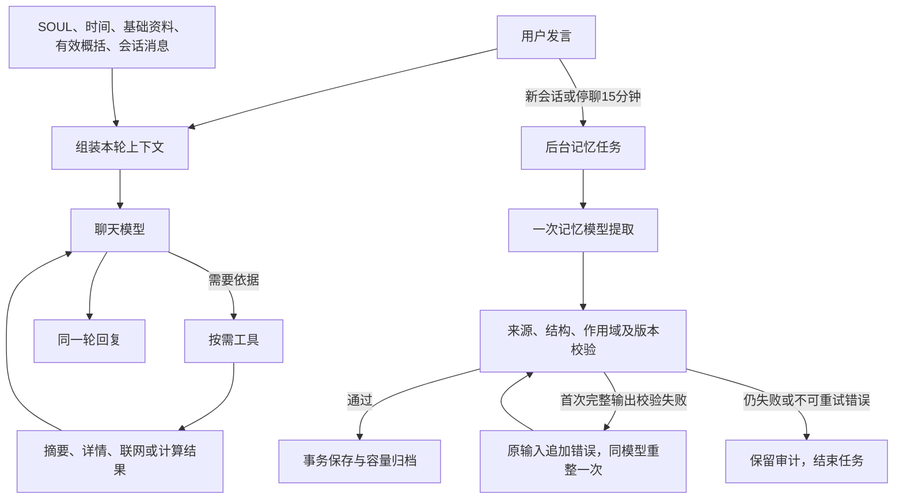

> 1.2.0默认公开体验把用户资料、聊天与记忆持久化在浏览器，请求期间在服务器内存运行；公共角色设定由独立SQLite持久化共享。详见[浏览器本地架构](browser-local-demo.md)和[公共角色库](public-role-library.md)。下文会话与记忆表是访客内存快照的执行模型；旧私有模式另可将整个工作区存入磁盘SQLite。

# 架构与执行流程

本文件描述维护分支 `version1.2.0`：应用版本1.2.0、记忆框架6，包含当前线上的公共角色库功能。角色手动填写名称与完整角色设定，新建后即公开，创建者可以编辑、删除；个人聊天与记忆仍按浏览器隔离。整体是单进程的聊天实验台，包含聊天 Agent 与会话结束后的记忆整理 Agent，没有额外逐轮记忆判别模型。

## 模块分工

| 位置 | 职责 |
| --- | --- |
| [server.mjs](../server.mjs) | HTTP接口、静态页面、流式聊天和服务启动／关闭。 |
| [lib/access-gate.mjs](../lib/access-gate.mjs) | 服务端共享口令校验、进入凭证与退出。 |
| [lib/public-catalog.mjs](../lib/public-catalog.mjs) | 公共角色持久化、创建者权限、幂等创建、修订冲突和删除墓碑。 |
| [lib/browser-workspace.mjs](../lib/browser-workspace.mjs) | 访客快照校验、临时内存执行、受控默认角色更新与结果导出。 |
| [public/local-workspace.js](../public/local-workspace.js) | IndexedDB持久化、缓存、跨标签租约及中断恢复。 |
| [lib/runtime.mjs](../lib/runtime.mjs) | 聊天模型循环、工具执行、会话超时、后台记忆任务及用量记录。 |
| [lib/prompts.mjs](../lib/prompts.mjs) | 共用规则、SOUL加载、实际系统提示词及每轮资料组装。 |
| [config/](../config/) | 无凭据运行配置，以及旧数据库首次导入使用的角色配置。 |
| [lib/store.mjs](../lib/store.mjs) | SQLite表、会话、记忆、来源、事务、版本与归档。 |
| [lib/memory-prompt.mjs](../lib/memory-prompt.mjs) | 当前记忆提取提示词，基于DeerFlow记忆更新思路适配轻量聊天。 |
| [lib/memory.mjs](../lib/memory.mjs) | 提取输入、用户来源编号映射和输出严格校验。 |
| [lib/memory-repair.mjs](../lib/memory-repair.mjs) | 完整提取结果校验失败时的单次定向重整。 |
| [lib/tools.mjs](../lib/tools.mjs) / [lib/search.mjs](../lib/search.mjs) | 四个聊天工具与方舟联网适配器。 |
| [lib/usage-cost.mjs](../lib/usage-cost.mjs) | 供应商用量回执与费用快照预估。 |
| [public/](../public/) | 聊天界面、角色图鉴和上下文／记忆调试面板；`motion-ui.css` 提供每次刷新时的轻量进入动画，不介入聊天逻辑。 |
| [test/](../test/) | 合成资料、模拟模型及独立数据库回归测试。 |

## 角色存储与提示词

公共角色原文保存在服务器独立公共角色SQLite，同步到浏览器快照的 `agents` 表；每次请求导入临时SQLite后，以公共库权威修订校准。旧本机角色和内置角色私人编辑仅保存在本机；不会自动公开。人工输入只有 `name` 和 `definition`，以原文保存；隐藏的 `revision` 用于并发编辑校验。新建生成独立ID，编辑沿用原ID。管理凭证只在浏览器元数据和公共管理请求头中使用，不进入工作区快照或模型输入。

平台管理 `COMMON_PROMPT`，角色层采用：

```text
COMMON_PROMPT

【名称】name
【角色设定】definition原文
```

`definition` 由作者维护完整设定，不再拆为多个性格字段，也不通过模型改写。概览、编辑器和提示词详情都读取该记录。保存后立即更新运行时角色映射；进行中的聊天继续使用已组装的系统提示词快照，下一轮使用新修订。记忆仍按用户 × 角色ID隔离，编辑不换ID或重置数据。

公共角色接口直接受共享入口认证保护；工作区角色读取和私人修改通过 `/api/local` 封装下面对应业务路径：

| 请求 | 行为 |
| --- | --- |
| `GET /api/catalog` | 查看公共角色及本机管理权限，可按revision轻量探测变化。 |
| `POST /api/catalog/agents` | `{name, definition, requestId}` 幂等创建公共角色。 |
| `PATCH /api/catalog/agents/:id` | 创建者提交 `{name, definition, revision}` 更新公共设定。 |
| `DELETE /api/catalog/agents/:id` | 创建者提交 `{revision}` 下架公共角色；历史、记忆保留。 |
| `GET /api/agents/:id` | 读取当前完整原文及revision。 |
| `PATCH /api/agents/:id` | 仅本机私人编辑，公共角色不能绕过公共管理权限。 |
| `DELETE /api/agents/:id` | 仅删除本机自建角色；内置角色不可删，公共角色须走公共管理接口。 |
| `GET /api/agents/:id/prompt` | 查看当前实际渲染的共用规则和角色原文。 |

新公开工作区导入8个内置角色，再同步公共角色库；私人修改按原有规则保留。删除使用隐藏标记和公共ID墓碑，不级联删除历史、记忆或后台来源，旧快照不能复活已下架公共角色。旧私有模式保留数据库迁移和原 `POST /api/agents` 创建路径，不能作为公共模式的权限绕过入口。

平台指纹只包含共用规则、记忆规则及渲染契约；角色名称、内容、数量和修订不参与，因此角色编辑不触发数据版本冲突。当前兼容升级明确接纳上一部署指纹，未知不兼容版本仍拒绝启动。业务正文限制64KB；公开模式额外允许最多16 MiB的访客快照封装。

## 聊天链路



每轮系统提示词由共用规则和当前SOUL组成。用户资料头部带真实当地时间、基础档案、有效用户概括，以及存在时的最近成功联网结果；随后带本会话的用户和助手文本。内部字段 `children`／`childId` 沿用历史命名，不限定用户年龄。

连发用户消息先保存，短暂停顿后一起提交；连续用户消息在模型输入中合并。工具调用先显示一句短承接，返回后自动在同一轮续答。普通单点问题以1–3句为软目标，详细、比较或复杂问题按需展开，具体语气沿用SOUL；每次聊天模型调用保留1400 token技术上限。篇幅指导不是可靠硬约束，见[已知限制](known-limitations.md)。

## 按需工具

| 工具 | 用法 |
| --- | --- |
| `recall_memory` | 当前资料不足以回答用户背景、偏好、经历、计划或进展时，按话题查询活跃与归档记忆摘要。宽泛问法也可先查。 |
| `get_memory_detail` | 摘要已足够就直接答；需要具体时间、安排、经过或变化时，再按ID读取原详情和补充／更正。 |
| `search_web` | 需要核实的公开信息缺少可靠依据时，主动联网；每轮最多一次。 |
| `calculate` | 执行允许范围内的本地算式计算。 |

概括不是全部记忆。当前对话中的明确更正优先；查询未找到时，只说明本次未找到并按需补充线索。日期参数 `fromDate`／`toDate` 表示实际聊到这条记忆的日期，不是事情发生或计划发生日期。

联网检索由独立搜索模型通过方舟联网内容能力执行，聊天模型组织最终回答。同次检索可兼顾紧密相关的追问。预报、预计和计划保留资料性质；检索／发布时间不等于观测或事件时间。资料不能证明此刻实况时，回复应说明能确认的范围。

同用户、同SOUL、同会话的 `sessions.context.previousWebSearch` 保留最近一次成功结果：普通聊天继续保留，失败不覆盖，新成功替换。后续轮次作为资料注入，不重放旧工具调用或重复记搜索费用；本轮聊天输入仍按实际token计量。新会话和其他作用域不继承该结果，时效是否足够仍由模型判断。

## 记忆与概括

记忆按用户 × SOUL隔离，基础档案共用。单条记忆包含稳定ID、类型、状态、摘要、主题词、原详情、来源、提及时间和变化历史：

- `understanding`：持续适用的背景、偏好、习惯、目标和相处约定。
- `event`：有接续价值的经历、计划、决定及进展。
- `summary`：简短说明是哪件事，保留必要识别信息和状态，便于查阅与初步匹配。
- `detail`：具体条件、数字、名称、原因、经过和感受；简单事实可没有详情。
- `detailChanges`：带来源的补充／更正增量，旧摘要另外保存在历史中。

工具读取区分当前摘要、原始详情和历史变化，不把旧详情当作已经覆盖更正后的单一对象。

用户概括从有效 `understanding` 来源组装，不是第三类独立事实。提取模型同次输出来源和审计草稿，后端用当前有效来源原摘要在1200字符预算内按完整条目组装。`overview:null` 时，存在长期了解变化可由后端从旧有效来源与本轮长期了解补齐；显式清空仍尊重。事件通常通过工具按需读取。

旧 `context_briefs` 派生概括功能保留兼容，但默认关闭。显式启用会有额外的概括模型调用，不属于默认单次整理流程。

## 会话结束后的提取

手动开启新会话，或最后用户消息后停聊满15分钟，旧会话进入后台队列。正在生成的回复先结束，再固定本次提取来源；新会话不等待旧任务完成。

一次提取输入为本次会话、用户原话与助手参考、旧概括和最多500条候选摘要。候选包含相关归档和活跃记忆，默认不全量加载旧详情。用户主证据用本次请求内的 `U1`、`U2` 等编号，模型只选择用户来源，后端映射回实际消息ID并计算提及时间。

输出协议为：

```json
{
  "creates": [],
  "updates": [],
  "mentions": [],
  "retractions": [],
  "overview": null
}
```

`updates` 使用原ID和 `supplement`／`correction`；新增细节放 `detailDelta`，摘要没有必要变化时可以沿用。用户实际重提刷新时间，后台加载和工具读取不刷新。归档条目再次实际提及时沿原ID激活。

每用户 × SOUL最多500条活跃记忆，完成全部变化后按最近实际提及时间从早到晚归档超额条目；同分按创建时间和ID稳定排序。归档保留正文、详情和来源，仍可查询；撤回与归档不同，撤回条目退出有效检索。

语义去重由模型判断，后端另以规范化摘要做精确去重兜底。当前精确去重命中时新详情可能未被合并，这是已确认未修复的问题，不能把“保存成功”理解为所有新细节都已入库，见[已知限制](known-limitations.md)。

## 校验、失败与数据保护

正常一次模型调用完成整理。只有完整模型响应在来源还原、解析或严格校验时失败，才保留原始请求并追加具体错误，让同一模型重整最多一次；失败完整JSON只保存本地审计，不回传模型。修正结果仍严格校验，通过后才事务提交。

截断、网络/API错误、超时、取消、输入问题及作用域／版本／提交冲突，不触发盲目修正。再次失败结束任务，不写入部分记忆。手动重试会启动新的尝试，正常一次、必要时再一次，均按实际用量记账。

本地保留 `stages.extraction`、必要时的 `stages.repair`、校验错误、供应商回执、用量和手动尝试历史。严格校验只证明结构和引用有效，不证明语义完全正确。

默认 `CHAT_ALLOW_DATA_RESET=0`；未知不兼容指纹会在删除旧数据前拒绝启动。兼容迁移只接受代码明确列出的旧指纹。升级应备份自己的数据库，不通过自动清空来掩盖兼容性问题。

`ChatStore.clearMemories(now)` 是单独的人工维护操作，不由角色保存或普通升级触发，也没有新增网页清理接口。显式执行前停服并备份；有正在运行的聊天／整理任务则整笔拒绝。它清空记忆、概括、提及及旧画像，保留角色、用户、聊天消息和费用账本；结束旧会话并封存旧整理任务，避免旧消息自动重新提取。新会话仍正常整理。

## 使用边界

本应用没有面向公网的完整账号鉴权、生产级租户权限或自动数据迁移系统。用户 × SOUL的逻辑隔离不能替代账号授权。适合本机或可信局域网实验，不包含公网部署步骤。

公开源码不包含本机数据库、私人参考录音、原始聊天或真实模型回执。参考声音是可选展示能力，公开默认不带私人音频或试听入口；自备有权使用的音频后再配置，不影响文字聊天核心。更多当前行为边界见[已知限制](known-limitations.md)。

## 页面与进入动画

顶部仅保留角色、用户、会话等实际操作，聊天区拥有主要宽度和高度。`motion-ui.css` 在页面加载时让聊天区先出现，辅助面板稍后出现，总长不超过600ms；每次刷新自然重播。动画为纯CSS，没有全屏片头、播放按钮、模态dialog、存储标记或动画专用JavaScript。系统要求减少动态效果时直接展示。没有任何等待动画完成后才能输入的逻辑；角色、会话、工具、记忆和数据指纹保持原有行为。见[设计说明](design/motion-ui.md)。
