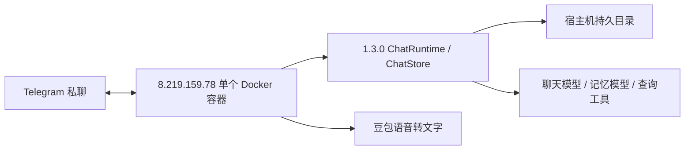

# ChatLab 1.3.0 → Telegram 兼容方案

状态：已部署到8.219.159.78单个Docker容器；健康检查通过。本地338项回归及服务器20项专项测试通过。开发分支 `release1.3.0-telegram`，基于 `v1.3.0` / `f6877a6`。现有网页版和已发布版本保持原样。

首批范围：你和少数受邀用户私聊；输入文字或语音，角色只回复文字；默认林小满、鳄鱼爸爸、大肥鱼、林晚晴。自建角色默认只对创建者可见。

## 1. 部署分工（按用户最新决定调整）

Telegram长轮询入口、指令、聊天、记忆调度、语音转写和发送队列在同一容器内运行。不向公网开放后端端口。此前的“网关在8.219、聊天核心留成都、专用SSH通道”设计由本轮决定替代。

成都现有1.3.0网页服务不改动。Bot复用其源码与模型配置，Bot用户数据独立保存，不自动合并浏览器历史。

宿主机 `/var/lib/chat-lab-telegram` 挂载到容器同名目录，重建容器仍可恢复。运行配置在项目外 `/etc/chat-lab-telegram/bot.env`，只读运行、非root用户、320MB内存上限和日志轮转。现有服务器其他容器不变。

## 2. 哪些复用，哪些新增

| 部分 | 1.3.0现状 | Telegram如何兼容 |
|---|---|---|
| 人物与模型 | name + definition、共用规则、作用域世界观 | 使用相同角色原文、模型、思考关闭设置；渠道说明单独提供，不重写人物。 |
| 用户身份 | 浏览器工作区里的profile / childId | 以bot_id + Telegram user_id定位工作区，再映射内部profileId；用户名改了也不换人。 |
| 数据落盘 | 网页由IndexedDB持久保存，后台临时内存SQLite | Bot采用ChatStore的持久SQLite模式，每个受邀用户一个工作区文件，聊天和记忆都在服务端。 |
| 短期上下文 | 当前角色、当前会话的真实消息 | 按用户和角色恢复原会话，直接用已保存消息，不让模型靠摘要猜刚才聊了什么。 |
| 新会话 | 主动新开，或15分钟无新消息后归档 | Bot后台接管定时器；/new清短期上下文但保留长期记忆。 |
| 记忆提取 | 框架6：提取、来源校验、一次定向修正、事务提交 | 复用原流程。Bot新增持久调度、重启恢复和可见任务状态，不另写一套自由摘要。 |
| 记忆读取 | 概括 + recall_memory + get_memory_detail | 原工具继续使用当前用户×当前角色的库；不一次把所有记忆塞进每轮输入。 |
| 角色切换 | 每个角色独立历史与记忆 | 切到B不拼入A的私聊；切回A按原会话/归档状态继续。 |
| 语音输入 | 本版没有Telegram语音入口 | 网关下载文件后交ASR，转写作为本轮用户文字；保留来源和纠正记录，不把识别服务报错当用户发言。 |
| 文字回复 | messages数组和reply_part | 每个数组项对应一条Telegram消息，项内换行仍是段落。 |
| 管理指令 | 网页按钮和表单 | 用指令与内联按钮调用同样的业务操作；指令、按钮和识别状态不进入人物聊天记忆。 |
| 并发与重试 | requestId、运行状态及保存恢复 | Bot新增持久收件箱、每用户顺序队列和发送箱；更新重投不重跑模型。 |
| 版本更新 | 默认角色受控升级，私改与数据保留 | 复用版本兼容清单和定义hash规则；Bot升级也禁止因版本变化清库。 |

## 3. 持久数据结构

Bot工作区保存在 `/var/lib/chat-lab-telegram/`，独立于网页公共角色库：

- `bot.sqlite`：Bot身份、拉取offset、用户索引、持久收件箱与发送箱。
- 各用户的ChatStore内保存当前角色、命令/语音草稿、操作回执、个人资料；业务操作和回执在同一事务内提交。
- `users/<bot_id>/<telegram_user_id>.sqlite`：复用ChatStore表结构，保存该用户各角色、messages、sessions、jobs、memories、mentions、overview、usage等。
- 目录0700、工作区文件0600。使用SQLite事务/WAL，不把这些数据写入Git。跨文件一致性备份先优雅停止Bot，再归档整个持久目录；不直接复制运行中的单个SQLite主文件。

每个用户的文件由服务端根据已验证身份选择，不接受用户输入数据库路径、他人的user_id或profileId。少量测试用户先采用物理工作区隔离，不把多租户安全寄托在每条SQL都手写正确的WHERE条件上。

新工作区显式初始化，不带入原私有实验用户或网页演示年龄。Telegram昵称只作显示名称；不从声音或头像推断年龄。受年龄限制的角色继续执行已有规则，未填写必要资料时不绕过限制。

## 4. 聊天如何接得上

1. 每条更新先持久接收。正常输入、切角色和新会话命令按同一用户的顺序处理，不同用户可以并行。
2. 开始处理这条消息时确定角色与会话，随后固定本轮作用域。语音转写过程中收到切换命令，按队列顺序生效，不能把旧角色那句交给新角色回复。
3. 组装原版上下文：人物和世界观、当地时间、用户资料、该角色有效概括、当前会话消息，以及按需读取的记忆/工具结果。
4. 首版逐条按序处理，保留原始message_id和update_id。连发自动聚合尚未实现；不会宣称已经合并了多条用户消息。
5. 同一个角色切回来，未结束就接原会话；超过15分钟则进入新会话，用长期记忆承接。不是每收到一条Telegram消息就新开一个会话。

### 记忆尚未整理时的空档

已新增有来源、有限长度的“最近会话衔接”：只读取同一用户、同一角色刚结束的原始记录；明确它是近期原文、未必已归档，不伪装成长期记忆。整理完成后停止额外注入，避免与概括重复。该读取须遵守清空时间边界，清空前的历史不能为“接话”自动拼回。

实现限定为最近36小时、最多两份未成功整理会话、最后12条原文且总计不超过6000字符；按来源提供给本轮，不改人物提示词。通过了未整理、失败、成功、角色隔离和清空边界测试。

## 5. 记忆怎么提取、保存、更新

### 提取时机

- 当前角色主动 `/new`：关闭前一会话，建立整理任务。
- 当前会话15分钟没有新输入：后台关闭并建立任务，无需用户保持Telegram窗口打开。
- 重启：读取持久任务和到期时间；尚未发起的queued任务可以继续，已发起但结果不明的任务不盲目再调用。

### 提取内容

沿用框架6：根据实际用户消息提取值得留下的理解、经历和计划，保留来源消息、日期、作用域及更正关系。名字和公开指令不是默认记忆；助手的猜测、按钮文案、工具状态不能冒充用户事实。

使用独立记忆模型，校验真实来源、字段结构及记忆修订；完整输出首次校验失败才定向修正一次，成功后事务提交。普通格式失败不把无效JSON部分写进库。

### 后续提及和纠正

重复聊到旧事更新其提及关系；用户明确更正时按原规则修改或撤回，不把新旧矛盾信息都当事实。每用户×角色的500条活跃容量及归档检索继续复用。

### 失败与清空

提取失败保留原聊天和可查任务状态，允许明确重试，不吞错、不反复自动付费。`/memory`显示本角色记忆与整理状态。

`/forget`必须明确显示角色并二次确认；有运行中的提取先等待其结束，沿用原版作用域清空和旧任务封存。只清当前用户×当前角色；历史记录可以保留供查看，但清空前的内容不能再自动进入新上下文或被旧任务重新提取。`/new`和`/forget`是不同操作。

## 6. 语音如何兼容

链路：Telegram voice → 网关下载 → 安全传给ASR → 展示转写 → 文字聊天。

- 复用已有Croco开发环境的豆包录音极速识别配置模式，凭据保存在项目外，资源为volc.bigasr.auc_turbo；实际识别验证单独记录。
- Telegram下载URL含Bot Token，不能把这个URL直接传给识别服务。优先传音频字节；若选定服务要求URL，用独立的短期授权对象地址，不带Bot Token。
- 首版单条不超过2分钟、8MB，是产品限额；下载时也校验实际字节数，不能只信元数据。
- 首版固定先确认：显示“识别为：……”，点确认才调用聊天模型；用/correct 正确内容纠正，用/cancel取消。确认消息与原语音update_id关联。已进入聊天后的重答/撤销转写暂未做专门入口。
- 识别失败、空白或超时就提示重新发，不把报错送给人物模型，不凭音频时长猜内容。
- Bot下载音频只在内存中处理，不保存为用户音频文件；保存转写、纠正回执和必要来源元数据。Telegram平台仍保留原语音。
- 本版只有语音输入，没有TTS输出。录音文件/附件是否支持另行列明，不能把支持voice等同于所有格式都支持。

## 7. 消息格式、顺序与重启

- 使用持久inbox唯一约束记录bot_id + update_id，并关联chat_id/message_id。只在已经持久接收或可靠移交核心后推进拉取offset。
- 相同更新再次到达，复用同一requestId；不追加重复用户发言、不再次调用模型。
- ChatRuntime先保存用户消息和run；结果完成并提交后，写入outbox。中间断电可从已完成run重建待发送项，不重跑模型。
- 发送箱记录逻辑消息序号、平台分片序号、状态和Telegram返回的message_id。收到明确成功就不重发；限流按retry_after等待，不重新生成回答。
- 平台超时有可能已经收到了消息，而客户端没有拿到回执。不能承诺绝对一次投递；这类标记为发送结果不明，不无限自动重发。用户可选择重发已有答案，区别于重新调用模型。
- 第一版先用“输入中/正在识别”等界面状态，人物消息以保存完成的结果为准，避免用户看到了回答但历史还没存好。
- 1.3.0的日常短消息规则保持不变。明确长回复超过Telegram单条4096字符时才做传输分片，内部仍保留同一个逻辑消息，不能把平台分片再当成新一轮聊天。
- Telegram只有一个Bot发送身份；切换时提示当前角色，不承诺同一Bot的每条消息都能换成不同角色头像/发送者。

## 8. 第一版功能菜单

优先提供按钮菜单：角色、新会话、我的角色、记忆、设置。命令是同一操作的快捷入口，不要求用户背一堆指令。

| 指令 | 作用 |
|---|---|
| `/start` `/help` | 初次引导、当前角色、菜单说明。 |
| `/roles` `/role` | 列出可用角色、切换及查看当前角色。 |
| `/new` | 当前角色开启新会话；保留长期记忆。 |
| `/history` | 查看本人的本角色历史，先只查看，不假装能直接接着任何已结束会话继续写。 |
| `/create` `/myroles` | 名字＋完整设定创建私人角色、列出自己的角色。 |
| `/editrole` `/deleterole` | 仅操作自己的角色；保留ID与记忆，删除前确认，不允许删除系统角色。 |
| `/cancel` | 退出创建/编辑等流程，草稿不当作普通聊天。 |
| `/profile` `/settings` | 称呼、可选年龄和固定语音确认方式；本版时区为Asia/Shanghai。 |
| `/memory` | 当前角色的记忆摘要、提取状态和失败任务。 |
| `/retrymemory` | 明确重试当前角色最近失败的记忆任务，会再次调用记忆模型。 |
| `/forget` | 二次确认后清本角色记忆，不误清其他角色。 |
| `/stop` | 停止当前生成；与删除聊天、清记忆分开。 |
| `/status` `/usage` | 本人的队列、角色、模型和用量；ASR费用与聊天、记忆分开。 |
| `/id` | 查看自己的Telegram ID，便于首批白名单开通。 |

管理采用项目外白名单配置，最多16名受邀用户；默认每人每天200次聊天生成（UTC日期），重放已有结果不扣新次数。一次性邀请、在线撤权和管理菜单尚未实现。未开通账号只能读取自己的ID及开通说明。

第二批再考虑：AI帮写角色草稿并预览确认、带权限的角色分享、聊天导出/完整删除、网页账户绑定、群聊与多人上下文。Bot创建的角色不调用网页“创建即公开”的接口，避免误发布私人设定。

## 9. 实现模块与验收

新增 `telegram.mjs`、`lib/telegram/{app,core,database,platform,asr}.mjs` 和Docker部署文件。原网页模块给种子升级、角色隐藏、作用域清空三个函数增加export，逻辑不变；输出防抄索引改为低内存实现，逐片段行为与旧实现对照一致。

本地回归338项通过（原318项＋Telegram19项与索引等价测试1项）。真实聊天模型、记忆提取和新会话回忆已通过独立模拟用户测试，未写入任何真人聊天库。服务器和语音验证结果见本任务私有verification回执及部署说明。

必须验收：

1. 用户A与B都用同名角色，不串历史和记忆；用户名改名不丢记录。
2. 同人A角色聊一件事，切B再切回，不把A聊天塞给B。
3. /new、15分钟到期、提取尚未完成、提取失败、重启恢复都能分辨处理。
4. 重复提及、明确更正、撤回和500条归档仍按框架6执行。
5. 清空期间有旧任务或旧上下文，不能把记忆恢复回来。
6. 同一update重投、按钮连点、文字连发、语音转写途中切角色，不重复计费或串角色。
7. 接收后/模型完成后/发送前/发送结果不明时断电，各自有确定恢复策略。
8. 语音识别错、空音频、超限、下载失败、ASR断连，不捏造文字。
9. messages多条与单条多段、代码和超长内容在Telegram显示正确。
10. 私人角色只有本人可编辑，系统角色和历史记录保留；年龄限制不能通过切角色或发言绕过。
11. Bot中断时有持久队列状态，模型失败时不无限重试；不能因为Bot部署而影响网页1.3.0。

## 10. 运行与尚未覆盖的范围

- 分支为release1.3.0-telegram，基于已发布1.3.0。未自行发布新Release或推送分支。
- 8.219.159.78使用专用SSH公钥长期认证，密码不保存。
- 机器人为@CrocoDaddy_ChatLabBot，头像使用项目public/assets/benny.png；Token只在外部私有配置。
- 首位用户ID经用户本人确认后才加入白名单，不自动让第一个/start用户成为管理员。
- Docker配置和日常操作见[Telegram部署说明](telegram-deployment.md)。
- 尚未做：跨网页账号绑定、群聊、角色分享、连发自动合并、历史编辑、应用内管理员邀请、自动备份调度和持续告警。Docker健康检查不等于有完整告警值班系统。
- 发送超时仍可能已经送达：标记unknown，不自动重发；/resend重发已保存回答。

## 官方接口依据

- [Telegram Bot API](https://core.telegram.org/bots/api)：长轮询/更新ID、voice/getFile、sendMessage长度、回调与限流。
- [Telegram Bot功能与BotFather](https://core.telegram.org/bots/features)：创建机器人、命令和内联按钮。
- [豆包录音文件识别极速版](https://docs.volcengine.com/docs/doubao-voice/recording-file-recognition-lite-http?lang=zh)：音频识别接口与格式支持。具体凭据、模型开通及字节上传方式仍需联调确认。
